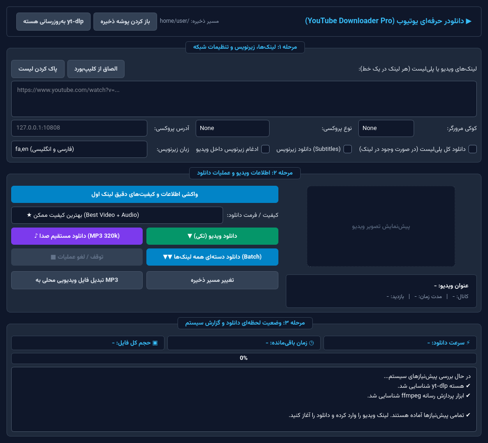

# 🎬 YouTube Downloader Pro (نسخه ۲.۰)


یک ابزار گرافیکی مدرن، سریع، امن و راست‌به‌چپ (RTL) برای دانلود ویدیو، پلی‌لیست، زیرنویس و استخراج صدا از یوتیوب که با استفاده از **PyQt6**، **yt-dlp** و **ffmpeg** توسعه یافته است.



---

## ✨ ویژگی‌های جدید در نسخه ۲.۰ (What's New in v2.0)

- 🎨 **رابط کاربری مدرن و کاملاً راست‌به‌چپ (RTL):** طراحی تیره (Dark Slate) چشم‌نواز و بهینه‌شده برای زبان فارسی.
- 🎵 **دانلود مستقیم فایل صوتی (MP3 320kbps / M4A):** امکان دانلود مستقیم صدا از لینک یوتیوب به همراه کاور و متادیتا، علاوه بر قابلیت تبدیل فایل‌های ویدیویی محلی به MP3.
- 📜 **پشتیبانی از پلی‌لیست و زیرنویس:** امکان دانلود کامل پلی‌لیست‌ها با شماره‌گذاری خودکار و دانلود/ادغام زیرنویس‌های فارسی و انگلیسی (`fa, en`).
- 📊 **نمایش زنده آمار دانلود:** نمایش لحظه‌ای سرعت دانلود (`Speed`)، زمان باقی‌مانده (`ETA`)، حجم فایل و درصد پیشرفت.
- ⏹️ **قابلیت توقف و لغو عملیات (Stop / Cancel):** امکان توقف ایمن دانلود یا فرآیند تبدیل در هر لحظه بدون هنگ کردن برنامه.
- ⚡ **آماده به کار بدون نیاز به واکشی اولیه:** دارای پروفایل‌های کیفیت آماده (`بهترین کیفیت`، `1080p`، `720p`، `480p`، `MP3`) و همچنین امکان واکشی دقیق تمام فرمت‌های اختصاصی هر ویدیو به همراه نام کانال، مدت زمان و تعداد بازدید.
- 💾 **ذخیره خودکار تنظیمات:** ذخیره مسیر دانلود، تنظیمات پروکسی (`HTTP`, `SOCKS4`, `SOCKS5`) و مرورگر منتخب برای استفاده‌های بعدی.
- 🔄 **به‌روزرسانی تک‌کلیکی هسته `yt-dlp`:** دکمه داخلی برای آپدیت سریع `yt-dlp` جهت رفع خطاهای `403 Forbidden` یوتیوب.
- 🔒 **امنیت بالا در برابر تزریق فرمان و آرگومان (Argument & Command Injection):** اعتبارسنجی دقیق لینک‌ها و پروکسی و جداسازی کامل آرگومان‌های سیستمی.

---

## 🛠️ پیش‌نیازها (Prerequisites)

- **Python 3.8** یا بالاتر
- **ffmpeg** (ضروری برای ادغام ویدیو و صدای کیفیت‌های بالا مثل 1080p و تبدیل فایل‌های صوتی MP3)
- کتابخانه‌های پایتون: `PyQt6`، `yt-dlp` و `requests`

### نصب در لینوکس (Ubuntu / Debian)

```bash
sudo apt update
sudo apt install -y ffmpeg fonts-vazirmatn
pip install -r requirements.txt
```

### نصب در ویندوز (Windows 10 / 11)

1. زبان [Python](https://www.python.org/) را نصب کنید (تیک گزینه `Add Python to PATH` را بزنید).
2. ابزار [ffmpeg](https://ffmpeg.org/download.html) را دانلود کرده و در `PATH` ویندوز قرار دهید (یا با دستور `winget install Gyan.FFmpeg` در ترمینال ویندوز نصب کنید).
3. پیش‌نیازهای پایتون را نصب کنید:

```bash
pip install -r requirements.txt
```

---

## 🚀 نحوه اجرا (How to Run)

### ۱. نسخه دسکتاپ (ویندوز و لینوکس):
```bash
python ud.py
```

### ۲. نسخه موبایل و تحت وب (اندروید / آیفون / Termux):
اگر با **گوشی موبایل** کار می‌کنید، نسخه تحت وب (`web_app.py`) به طور ویژه برای صفحه نمایش موبایل طراحی شده است:

#### اجرا در اندروید با برنامه Termux:
کافی است برنامه **Termux** را روی گوشی نصب کنید و این دستور یک‌خطی را در آن کپی کنید:
```bash
pkg update -y && pkg install -y git python ffmpeg && git clone https://github.com/voughtboysjj-rgb/YouTube-Downloader.git && cd YouTube-Downloader && bash termux.sh
```
سپس در مرورگر گوشی (Chrome) آدرس `http://127.0.0.1:5000` به صورت خودکار باز می‌شود و می‌توانید ویدیو و MP3 را مستقیماً در حافظه گوشی دانلود کنید!

#### اجرای نسخه وب روی سرور یا کامپیوتر:
```bash
python web_app.py
```

---

# 🌐 English Documentation

**YouTube Downloader Pro** is a modern, secure, and feature-rich desktop GUI application built with **PyQt6**, **yt-dlp**, and **ffmpeg** for downloading YouTube videos, playlists, subtitles, and high-quality 320kbps MP3 audio.

### Key Features

- **Smart Quality Selection:** Choose from instant presets (`Best Quality`, `1080p`, `720p`, `480p`, `360p`, `MP3 320kbps`, `M4A`) or fetch the exact format table (resolution, codec, FPS, and file size) for any video.
- **Direct Audio & Local Converter:** Download YouTube links directly as 320kbps MP3 with embedded thumbnails, or convert local video files (`.mp4`, `.mkv`, `.webm`, `.avi`, `.mov`) to MP3.
- **Playlist & Subtitle Support:** Toggle full playlist downloading and automatically fetch/embed subtitles (`fa`, `en`, or `all`).
- **Live Telemetry & Cancel Control:** Real-time download speed, ETA, and file size indicators with a safe **Stop / Cancel** button.
- **Network & Anti-403 Resilience:** Built-in `HTTP` / `SOCKS4` / `SOCKS5` proxy support, browser cookie extraction (`Firefox`, `Chrome`, `Edge`, `Brave`, `Opera`, `Vivaldi`, `Chromium`), automatic fragment retries, and one-click `yt-dlp` updater.
- **Security Hardened:** Strict URL/proxy validation and safe argument delimiters (`--`) without `shell=True` to prevent Command and Argument Injection.

### Quick Start

```bash
git clone https://github.com/voughtboysjj-rgb/YouTube-Downloader.git
cd YouTube-Downloader
pip install -r requirements.txt
python ud.py
```

---

## 📄 License | لایسنس

This project is licensed under the [MIT License](LICENSE).  
این پروژه تحت لایسنس [MIT](LICENSE) منتشر شده است.


